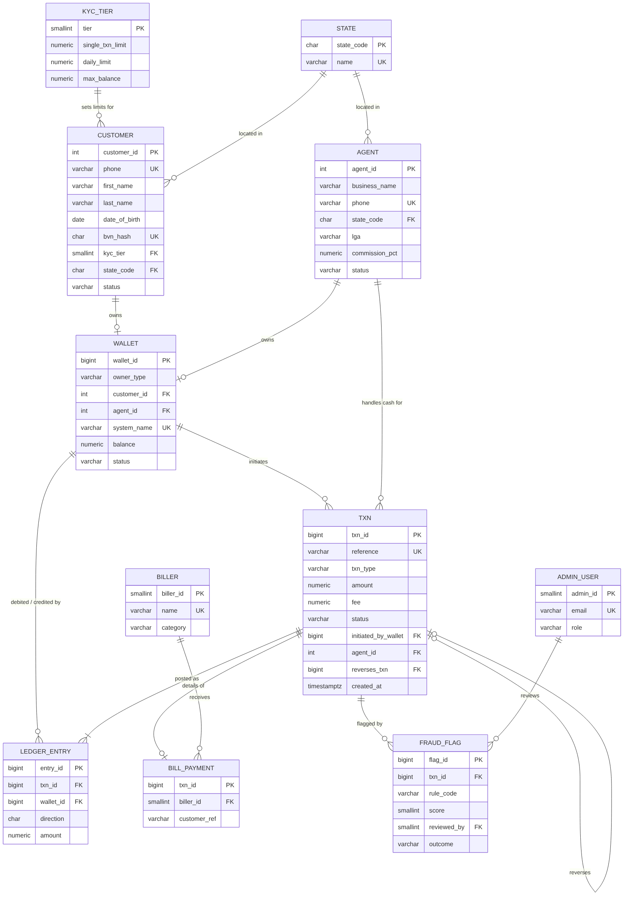

# Portfolio 1 – Database Design and Modelling

## 1. Selected case study: TapNaira Wallet (simulated fintech)

| Item | Description |
|---|---|
| **Organisation** | TapNaira, a fictional Lagos mobile-money company. Customers hold a naira wallet on their phone, and a network of agents (POS shops) handles cash in and cash out. |
| **Nature of the business** | Wallet-to-wallet transfers, cash deposits and withdrawals through agents, bill and airtime payments, and fraud monitoring |
| **Database users** | **Customers** (through the app), **agents** (through the POS app), **admin staff**: support, compliance (KYC and fraud review), finance (reconciliation), super-admin |
| **Major data** | Customers and KYC tiers, agents, wallets, transactions, double-entry ledger entries, billers and bill payments, fraud flags, audit log |
| **Key operations** | **Transfer money between customers** (the most important operation) · cash in and cash out at agents · pay bills · reverse a mistaken transfer · freeze a wallet · review fraud flags · produce statements and reconcile the ledger |

All later portfolios (2–5) use this case study.

## 2. Files

| File | Purpose |
|---|---|
| `erd.mmd` / `erd.png` | ER diagram in crow's-foot notation |
| `schema.sql` | DDL: 13 tables, keys, constraints, triggers and a statement view |
| `seed_data.sql` | Deterministic synthetic data (30,000 customers, 500 agents, about 304,000 transactions, about 764,000 ledger legs), with built-in validation |
| `constraint_tests.sql` | 9 operations that must fail and 1 that must succeed |
| `evidence/` | Seed validation and row counts; constraint test output |

```bash
createdb tapnaira
psql -d tapnaira -f schema.sql
psql -d tapnaira -f seed_data.sql          # about 25 s
psql -d tapnaira -f constraint_tests.sql
```

## 3. ER diagram



## 4. Key design decision: a double-entry ledger

A wallet balance is never just "edited". Every transaction (`TXN`) is posted as **ledger legs** (`LEDGER_ENTRY`), and the debits must equal the credits.

| Transaction | Debit (DR) | Credit (CR) |
|---|---|---|
| Transfer of ₦2,000 with a ₦10 fee | Sender wallet ₦2,010 | Receiver ₦2,000 + FEES wallet ₦10 |
| Cash-in of ₦5,000 at an agent | Agent wallet ₦5,000 | Customer wallet ₦5,000 |
| Cash-out of ₦3,000 + ₦50 fee | Customer ₦3,050 | Agent ₦3,000 + FEES ₦50 |
| Bill payment of ₦1,500 | Customer ₦1,500 | SETTLEMENT (paid out to the biller) ₦1,500 |

The ledger is used because money can't be created or destroyed by a bug: the whole ledger always sums to zero (`evidence/seed_validation.txt`: ledger net 0.00, sum of balances 0.00). Every balance can be rebuilt from history, which auditors and the regulator expect. Mistakes are corrected with a **REVERSAL** transaction, never by editing history.

## 5. Keys and integrity constraints

| Rule | How it is enforced | Test |
|---|---|---|
| Every transaction balances | **Deferrable constraint trigger**, checked at COMMIT after all legs are inserted | 1 |
| History cannot be changed | `BEFORE UPDATE OR DELETE` trigger on `ledger_entry` | 2 |
| Customers and agents can't overdraw | `CHECK (owner_type='SYSTEM' OR balance >= 0)` | 3 |
| A wallet has exactly one owner, matching its type | Multi-column `CHECK one_owner` | 4 |
| A retried request (network timeout, double tap) can't post twice | `UNIQUE(reference)`, an **idempotency key** | 5 |
| A transaction can be reversed at most once | `UNIQUE(reverses_txn)`, a self-referencing FK | 6 |
| KYC tiers 2–3 need BVN verification | `CHECK (kyc_tier = 1 OR bvn_hash IS NOT NULL)` | 7 |
| Customers must be 18 or over | `CHECK` on date_of_birth | 8 |
| Valid Nigerian phone number | `CHECK (phone ~ '^\+234[0-9]{10}$')` | 9 |
| One wallet per customer or agent | Partial unique indexes | – |
| Cash-in/out must name an agent; only reversals point to another txn | `CHECK` equivalence rules | – |

**Privacy (NDPA 2023):** the raw BVN is never stored, only a SHA-256 hash, which is enough to stop duplicate registrations (data minimisation). Wallet and transaction status changes are written to `audit_log` by triggers.

Surrogate keys (`IDENTITY`) are used for entities. Real-world identifiers (`phone`, `reference`, `bvn_hash`) are protected with `UNIQUE`. Natural keys are used for small code lists (`state_code`, `kyc_tier`).

## 6. Normalisation

**Starting point:** a flat "transaction receipt" sheet, as an agent might keep it.
```
RECEIPT(ref, date, type, amount, fee, sender_phone, sender_name, sender_tier, sender_tier_daily_limit,
        receiver_phone, receiver_name, agent_name, agent_phone, agent_state, biller_name, biller_category, meter_no)
```
- **1NF:** atomic values (names split into first and last); one row per receipt with a single key (`ref`).
- **2NF:** the key is a single column, so there are no partial dependencies. The cleanup work starts at 3NF.
- **3NF (removing transitive dependencies):**
  - `sender_phone → sender_name, sender_tier`: moved to **CUSTOMER**.
  - `sender_tier → daily_limit`: moved to **KYC_TIER**.
  - `agent_phone → agent_name, agent_state`: moved to **AGENT**, which references **STATE**.
  - `biller_name → category`: moved to **BILLER**.
  - Biller-specific fields (`meter_no`) apply only to bills, so they move to the 1:1 **BILL_PAYMENT** table, avoiding NULL-heavy columns.
- **Money movement:** "sender and receiver" columns can't describe fees or 3-way postings. They are replaced by **LEDGER_ENTRY** rows (one row per wallet affected), which is the double-entry design in section 4.
- **BCNF:** in each table, every determinant is a candidate key (for example, `phone` and `customer_id` both determine every customer attribute, and `phone` is UNIQUE).

**Controlled redundancy:** `wallet.balance` can be derived from the ledger. It is stored so that "check balance" reads one row instead of summing thousands. Portfolio 3 keeps it consistent by updating the balance and the ledger in the **same transaction**, and a reconciliation query (sum of ledger = balance) proves it.

## 7. Data volume (`evidence/seed_validation.txt`)

| Table | Rows |
|---|---|
| customer | 30,000 |
| agent | 500 |
| wallet | 30,502 (including the SETTLEMENT and FEES system wallets) |
| txn | 303,903 (about 2% FAILED, 300 REVERSED) |
| ledger_entry | 763,772 |
| bill_payment | 38,796 |
| fraud_flag | 1,774 |

All three validations pass: every transaction balances, the ledger nets to zero, and no customer or agent wallet is negative.
