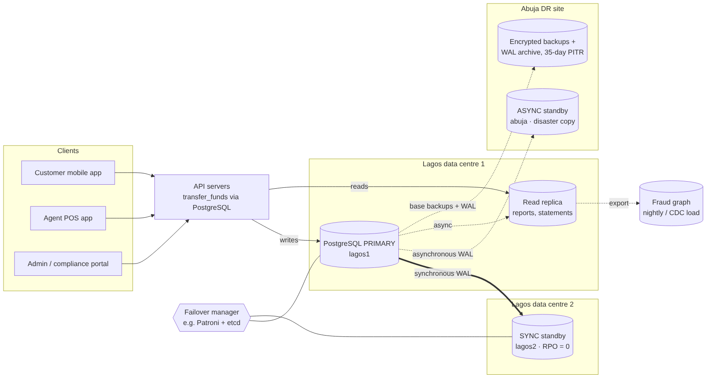

# Portfolio 5 – Distributed and Cloud Database Exercise

**Case study:** TapNaira Wallet. **Chosen replication design: both synchronous and asynchronous standbys.** A synchronous standby in a second Lagos data centre means no completed transfer is ever lost. An asynchronous standby in Abuja protects against a regional disaster without slowing every transfer.

| Part | Built | Evidence |
|---|---|---|
| A. Replication and failover | 3 PostgreSQL 16 nodes: primary **lagos1** (:5460), **sync** standby **lagos2** (:5461), **async** standby **abuja** (:5462) | `replication/replication_lab.sh` → `evidence/replication_output.txt` |
| B. Sharding and distributed transactions | Two shard nodes holding wallets split by `wallet_id % 2`; cross-shard transfers with and without two-phase commit | `sharding/start_shards.sh`, `sharding/sharding_2pc_demo.py` → `evidence/sharding_output.txt` |
| C. Deployment design | Two Lagos sites, an Abuja DR site, a read replica, backups and automatic failover | `cloud/architecture.png` |

```bash
sudo -u postgres bash replication/replication_lab.sh | tee evidence/replication_output.txt
sudo -u postgres bash sharding/start_shards.sh && python3 sharding/sharding_2pc_demo.py | tee evidence/sharding_output.txt
```
All nodes run on one machine on different ports to simulate separate sites. The real TapNaira data (30,539 wallets, about 304,000 transactions) is copied in. Transfers in the lab go through the real `transfer_funds()` procedure from Portfolio 3.

---

## A. Replication: sync + async (`evidence/replication_output.txt`)

| Step | Result |
|---|---|
| R1–R3 | Both standbys were cloned with `pg_basebackup -R` and replication slots. With `synchronous_standby_names = 'FIRST 1 (lagos2)'`, `pg_stat_replication` shows **lagos2 = sync** and **abuja = async**. |
| R4 | A transfer committed on lagos1 was visible on **both** standbys. |
| R5 | A transfer attempted on lagos2 was rejected: *cannot execute SELECT FOR UPDATE in a read-only transaction*. |
| R6 | **Cost of the sync copy:** 200 transfers took **371 ms async-only vs 451 ms with sync to lagos2** (+22%). That is on one machine; between real data centres each commit also pays the network round-trip. |
| R7 | **Abuja link cut:** 50 transfers still committed (in 118 ms), because only lagos2 is synchronous. The DR site going down doesn't stop payments. |
| R8 | **Both standbys down:** the transfer **waits** (`wait_event = SyncRep`). After cancelling, PostgreSQL warned *"committed locally, but might not have been replicated"*, so the app never tells the customer "success". This is **consistency over availability**: TapNaira would rather pause than risk losing confirmed money. |
| R9 | **Disaster: lagos1 crashes.** lagos2 (sync) had **452 of 452** lab transfers, so **RPO = 0**. abuja (async) had **401**: it missed the 51 made while its link was down, so **RPO > 0**. |
| R10 | **Failover:** lagos2 was promoted in **137 ms** and accepted new transfers. abuja was re-pointed to lagos2 and caught up to **453 of 453**. On the new primary: **0 unbalanced transactions and 0 wallets where balance ≠ ledger.** |

**Interpretation (CAP / PACELC)**
- **During a partition:** with the sync copy, TapNaira chooses **Consistency** (R8). With only async it would choose **Availability**, but could lose confirmed transfers (R9: abuja's 51 missing).
- **With no partition:** the trade-off is **latency against consistency** (R6, +22%).
- **Why "both" fits a payments company:** RPO = 0 against the likely failure, one data centre going down, at a small latency cost. Abuja then covers the rare regional disaster, where losing a few seconds is accepted and written into the DR plan.

**A bug found here and fixed:** `transfer_funds()` failed on the lab node with *relation "wallet" does not exist*, because that session had a different `search_path`. The procedure now pins `SET search_path = wallet` (updated in Portfolio 3). This is also a security best practice for stored procedures.

---

## B. Sharding and distributed transfers (`evidence/sharding_output.txt`)

**S0: the key finding.** I measured the real TapNaira transfers:

| Shards (hash of wallet_id) | Share of P2P transfers that cross shards |
|---|---|
| 2 | **49.8%** |
| 4 | **74.9%** |
| 8 | **87.4%** |

Any customer can pay any other, so **no wallet-based shard key keeps both sides of a transfer on one server**. Most transfers would become distributed transactions.

| Demo | Result |
|---|---|
| S1 | Same-shard transfer: an ordinary local transaction, total unchanged |
| S2 | **Cross-shard transfer without coordination:** the debit committed on shard0, the credit failed on shard1 (receiver frozen), and **₦2,000 vanished**. Each shard was atomic, but the transfer wasn't. |
| S3 | **Two-phase commit** (`PREPARE TRANSACTION` / `COMMIT PREPARED`). Normal case: committed on both shards. Frozen receiver: phase 1 failed, so `ROLLBACK PREPARED` on shard0 and **nothing vanished** (total ₦10,000,000). |
| S4 | **Coordinator crash between PREPARE and COMMIT:** both shards kept the prepared transaction (`pg_prepared_xacts`) and **still held the row lock**, so another transfer from that wallet blocked. Recovery read the decision log and ran `COMMIT PREPARED`, and money was conserved. |

**Conclusion:** sharding TapNaira makes most transfers distributed. That adds latency, needs a coordinator with a durable decision log, and in-doubt transactions hold locks while the coordinator is down. **Recommendation: don't shard yet.** Scale up the primary, move reads to replicas, and archive old ledger rows. If volume eventually demands it, use a distributed SQL database that runs 2PC/consensus internally (for example Citus, YugabyteDB or CockroachDB) rather than hand-written 2PC.

---

## C. Deployment design



| Concern | Design |
|---|---|
| **Availability** | Primary in **Lagos DC1**, sync standby in **Lagos DC2**, automatic failover by a cluster manager (e.g. Patroni + etcd), tested in R10 |
| **Disaster recovery** | Async standby plus encrypted backups and WAL archive at the **Abuja** site, allowing point-in-time recovery. **Targets:** Lagos DC failure RPO = 0, RTO < 1 min; Lagos region failure RPO of seconds, RTO < 1 h. |
| **Read scaling** | A read replica serves statements, finance reports (Portfolio 2's Q7/Q8 and the materialised view) and the fraud-graph export (Portfolio 4). This keeps load off the transfer path. |
| **Data residency (NDPA 2023)** | All copies of customer and transaction data stay **in Nigeria** (Lagos and Abuja). Using a foreign cloud region would make this a cross-border transfer that needs an adequacy basis under the Act. |
| **Security** | TLS between all nodes, encrypted disks and backups, private network only. The replication role has `REPLICATION` rights only. Promotions and failovers are logged for audit. |
| **Monitoring** | Replication lag (`pg_stat_replication`), SyncRep waits (R8), prepared-transaction age (S4) and nightly ledger reconciliation (0 mismatches) |
